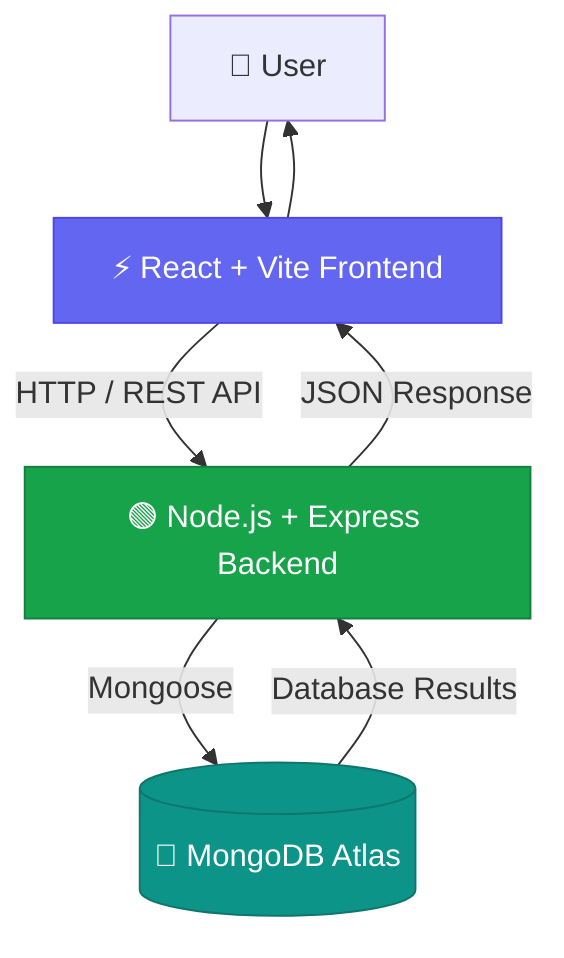

# ⚡ Workload Pulse

<div align="center">

  

  <p><strong>A modern full-stack task management application to organize work, track tasks, and stay productive.</strong></p>

  <p>
    <a href="https://workload-pulse-tau.vercel.app/">
      
    </a>
    <a href="https://github.com/chethanvamsiseemala-coder/workload-pulse">
      
    </a>
    <a href="https://workload-pulse-api.onrender.com/api/health">
      
    </a>
  </p>

  <p>
    
    
    
    
    
    
    
  </p>

</div>

---

## 🌐 Live Application

> **Workload Pulse is deployed and operational.** Create, manage, and organize your tasks through the live application.

| Component | Link |
|:---|:---|
| 🌍 Live Frontend | [workload-pulse-tau.vercel.app](https://workload-pulse-tau.vercel.app/) |
| ⚙️ Backend API | [workload-pulse-api.onrender.com](https://workload-pulse-api.onrender.com) |
| ❤️ API Health Check | [Check API Status](https://workload-pulse-api.onrender.com/api/health) |
| 💻 Source Code | [GitHub Repository](https://github.com/chethanvamsiseemala-coder/workload-pulse) |

## ✨ Key Features

<table>
  <tr>
    <td width="50%">
      <h3>📋 Task Management</h3>
      Create, view, update, and delete tasks through the application.
    </td>
    <td width="50%">
      <h3>💾 Persistent Storage</h3>
      Store task data in MongoDB Atlas so changes remain available after refreshing.
    </td>
  </tr>
  <tr>
    <td width="50%">
      <h3>🔗 RESTful API</h3>
      Communicate between the frontend and backend using HTTP endpoints.
    </td>
    <td width="50%">
      <h3>🛡️ Error Handling</h3>
      Handle API errors and backend connectivity issues.
    </td>
  </tr>
  <tr>
    <td width="50%">
      <h3>☁️ Cloud Deployment</h3>
      Host the frontend on Vercel and the backend on Render.
    </td>
    <td width="50%">
      <h3>⚡ Modern Development</h3>
      Use Vite, Node.js, Express, and Mongoose for development and API integration.
    </td>
  </tr>
</table>

## 🧰 Technology Stack

<div align="center">

| Layer | Technologies |
|:---|:---|
| **Frontend** | React, Vite, JavaScript, CSS |
| **Backend** | Node.js, Express.js |
| **Database** | MongoDB Atlas, Mongoose |
| **Communication** | REST API, HTTP, CORS |
| **Deployment** | Vercel, Render |
| **Version Control** | Git, GitHub |

</div>

## 🏛️ System Architecture

<div align="center">



</div>

### 🔄 How It Works

1. The user interacts with the React frontend.
2. The frontend sends HTTP requests to the Express API.
3. The backend processes requests and interacts with MongoDB Atlas through Mongoose.
4. The API returns responses to the frontend.
5. The interface updates to reflect the latest task data.

## 🚀 Getting Started

Follow these steps to run Workload Pulse locally.

### Prerequisites

Ensure you have the following installed:

- [Node.js](https://nodejs.org/)
- npm
- [Git](https://git-scm.com/)
- A MongoDB Atlas account or a local MongoDB instance

### 1. Clone the Repository

```bash
git clone https://github.com/chethanvamsiseemala-coder/workload-pulse.git
cd workload-pulse
```

### 2. Install Dependencies

Install the frontend dependencies from the directory containing the frontend `package.json`:

```bash
npm install
```

Install backend dependencies:

```bash
cd backend
npm install
```

> Run each command in the directory containing the corresponding `package.json`.

### 3. Configure Environment Variables

Create a `.env` file in the backend directory:

```env
PORT=5000
MONGODB_URI=your_mongodb_connection_string
CORS_ORIGIN=http://localhost:5173
```

Configure the frontend `.env` file in the frontend project root:

```env
VITE_API_BASE_URL=http://localhost:5000/api/tasks
```

**Important:** Replace the MongoDB connection string placeholder with your actual database connection string. If your backend uses a different port or environment variable name, use the values defined in your code.

Never commit `.env` files or database credentials to GitHub.

### 4. Start the Backend

From the backend directory, run the development script defined in its `package.json`, for example:

```bash
npm run dev
```

### 5. Start the Frontend

Open another terminal, navigate to the frontend project root, and run:

```bash
npm run dev
```

Open the local URL printed by Vite, usually `http://localhost:5173`.

## 🔌 API Reference

**Production base URL**

```text
https://workload-pulse-api.onrender.com
```

| Method | Endpoint | Description |
|:---:|:---|:---|
| `GET` | `/api/health` | Check backend health |
| `GET` | `/api/tasks` | Retrieve tasks |
| `POST` | `/api/tasks` | Create a task |
| `PUT` / `PATCH` | `/api/tasks/:id` | Update a task |
| `DELETE` | `/api/tasks/:id` | Delete a task |

<details>
  <summary><strong>❤️ Health Check Example</strong></summary>

  **Request**

  ```http
  GET /api/health
  ```

  **Example response**

  ```json
  {
    "status": "ok",
    "service": "Workload Pulse API"
  }
  ```

</details>

<details>
  <summary><strong>📋 Tasks Endpoint</strong></summary>

  Retrieve the current task collection:

  ```http
  GET /api/tasks
  ```

  The response structure depends on the implementation of the task routes.

</details>

> **Note:** Verify the exact update method, route parameters, and request body against `backend/src/routes/taskRoutes.js` before treating this table as the definitive API contract.

## ☁️ Deployment

Workload Pulse uses a separate deployment for each application layer.

| Service | Platform | Configuration |
|:---|:---|:---|
| Frontend | Vercel | `VITE_API_BASE_URL` |
| Backend | Render | `PORT`, `MONGODB_URI`, `CORS_ORIGIN` |
| Database | MongoDB Atlas | Database connection string |

### Frontend Environment Variable

Set the following in your Vercel project settings:

```env
VITE_API_BASE_URL=https://workload-pulse-api.onrender.com/api/tasks
```

### Backend Configuration

Configure the MongoDB connection string and allowed frontend origins in Render's environment settings.

Example `CORS_ORIGIN`:

```text
http://localhost:5173,https://workload-pulse-one.vercel.app,https://workload-pulse-tau.vercel.app
```

Only include origins that your application should allow.

## 🔐 Security Best Practices

- Keep database credentials and secrets out of source control.
- Never put private credentials in frontend environment variables prefixed with `VITE_`.
- Configure CORS to allow only trusted origins.
- Validate incoming data on the backend.
- Handle errors without exposing sensitive server information.

## 🗺️ Future Enhancements

- [ ] User authentication and authorization
- [ ] Task priorities and deadlines
- [ ] Search, filtering, and sorting
- [ ] Productivity analytics and dashboards
- [ ] Notifications and reminders
- [ ] Automated testing and CI/CD improvements

## 👨‍💻 Author

<div align="center">

  <h3>Chethan Vamsi</h3>
  <p>B.Tech — Computer Science and Engineering (AI &amp; ML)</p>
  <a href="https://github.com/chethanvamsiseemala-coder">
    
  </a>

</div>

---

<div align="center">

  <h3>⚡ Workload Pulse</h3>
  <p><em>Plan smarter. Stay organized. Get things done.</em></p>
  <p>If you find this project useful, consider giving the repository a ⭐</p>

</div>
